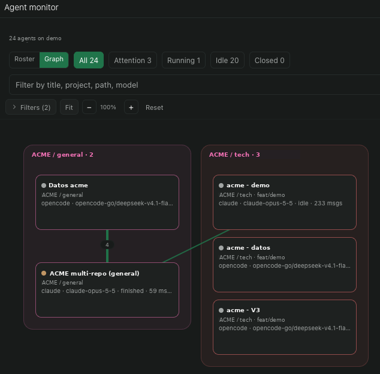

# agent-monitor

One roster for every agent on a daemon: an `Agent monitor` screen in the sidebar plus a global
Command Center item (`Open agent monitor`). The sidebar row also counts the agents
that need attention.

Answers "which of my 38 agents needs me right now" without walking the workspace tree.

## Demo

https://github.com/user-attachments/assets/3c841799-ed98-4ec4-86a0-a7917e3894fc

## Screenshots

Agent, project, and workspace names come from an isolated synthetic workspace. The roster and
settings PNGs were captured at 2× pixel density after browser DevTools replaced the local host
label and verified that no private organization names remained in the rendered page. The graph
screenshot uses the same synthetic project and agent names.

### Project-first roster


### Graph view



### Monitor settings


## What it shows

- Counts and filters by triage bucket: Attention, Running, Idle, Closed. Attention covers
  `requiresAttention`, `status === "error"`, and pending permission requests.
- Default layout groups agents by **project**, then by workspace under each project. Open the
  gear beside Refresh for the host-native Monitor settings screen, which can switch to workspace
  groups or a flat compact list.
- Settings also control float-pinned sorting, agent sort (triage / recently updated / title),
  collapse of matching workspace headers, density, default bucket, whether Closed stays out of
  All, and display toggles for diffs, pin markers, model, wait age, subagent counts, last error, and
  compact placement. Preferences are a typed, host-scoped document shared by connected clients.
  New hosts open on Attention by default; choose All or another bucket in Monitor settings.
- Workspace headers show up to two workspace labels and current `+additions −deletions`
  (additions in the success color, deletions in danger when color diffs are on).
- Per row: a status dot that separates errors (danger) from agents waiting on you (warning) and
  running agents (success), state and wait age on a right-aligned rail (`attentionTimestamp`,
  falling back to `updatedAt`), model, and `lastError` inline.
- Parent rows show their subagent count; child rows use a left indent guide.
- Text filter over title, agent id, provider, model, cwd, project, and workspace.
- **Graph view**: switch the header between Roster and Graph. Agents sit in compact
  project/workspace panels; provider-native subagents appear as dashed nodes. Edges encode parent
  hand-offs, timeline message provenance, and subagent dispatches, with thickness scaled by message
  count. Drag cards, pan the canvas, zoom with the wheel or a trackpad pinch, filter by project,
  workspace, provider, subagents, or connected-only. Tapping a card opens that agent straight away;
  tapping an edge focuses its neighbourhood and dims the rest.
- Select an agent row to open that agent, or select a workspace header (or its folder button when
  collapsed) to open its workspace through Paseo's cross-platform navigation API.
- Archive one agent, or sweep every closed agent (two taps).

## Sidebar row

- The row's badge counts the Attention bucket across every online host, using the same rule
  as the roster. It shows no number while loading, `N+` once an agent list reaches the 2,000-agent
  page limit or a host fails to load, and the popover lists those agents however many hosts they
  span.
- Press the badge for a popover of those agents, longest waiting first (up to eight), each
  with its host pill, provider, and wait age. Tapping one opens that agent's own screen on its
  host; **Open monitor** opens the roster filtered to Attention. Paseo 0.12 gives popovers no
  navigation, so the row opens the monitor with a one-shot handoff that the screen consumes
  before it paints.
- The monitor screen accepts a `bucket` param (`attention`, `running`, `idle`, `closed`, or `all`)
  as its initial filter, so a link such as `…/surface/monitor?param.bucket=attention` opens
  filtered and keeps that filter on reload. Chips then filter in place without changing the URL.

## How it reads state

`usePaseo().agents.list()` pages the daemon agent directory, `usePaseo().workspaces.list()` reads
workspace pin state, project id, and diff stats (200 per page, up to 10 pages each), and
`usePaseo().projects.list()` supplies registered project names, including custom renames, so an
agent whose workspace is beyond the paged workspace list still lands under its real project. Rows
refresh from agent, workspace, and project subscription deltas, debounced 750ms, with a 30s
backstop refetch. The screen, the sidebar row, and its popover share that query, subscription set,
and backstop; on web and desktop, refreshes pause while the window is hidden and catch up when it returns. The plugin
borrows the selected host's connection; it opens no socket of its own. Agents and workspaces in
background workspaces are included.

The graph reads the tail of each agent's timeline (200 entries, up to 60 agents, four at a time) to
derive message and subagent edges. Closed agents or unreadable timelines contribute no edges, and
the graph never opens a separate connection of its own.

## Multiple hosts

When the client connects to more than one host, the monitor merges every online host into one
screen. The header counts agents across hosts, host chips filter the roster, rows show their host
in compact placement lines, and project groups merge by base name so one project reads as one
group (a per-host display suffix such as `FINTERLACE · mac` does not split the group). The graph
adds a host filter row, shows the host in node details, and opens agents and workspaces on their
own host through the navigation `serverId`. Timeline sweeps run per host and merge, and archive
fans out to the owning host of each agent. A host that fails to load is named in a warning while
the rest keep working; the sidebar badge counts every online host. Every agent card carries a
host pill in the host's color, panels spanning hosts list them, and workspace and project headers
name their hosts, so each agent's host is visible at a glance.

## Limits

Interrupting a turn is not part of `PaseoApi`, so archive is the only lifecycle action here.

Popovers get no navigation in Paseo 0.12, so a popover row reaches an agent through the monitor
screen, which hands off to the agent before painting. On hosts without navigation the same tap
falls back to selecting the agent's card in the graph.

## Install

Requires Paseo `^0.12.0`, whose background workspaces the monitor lists. Development uses the 0.12 SDK line from the workspace catalog.

Install the published package on the daemon host:

```bash
paseo plugin install npm:@omercnet/paseo-agent-monitor
paseo plugin update agent-monitor
```

## Develop

```bash
bun install
bun run check
bun run test
bun run test:coverage
bun run typecheck
```

Release Please maintains the version, changelog, component tag, and GitHub release from
Conventional Commits in the monorepo.

The project supports Paseo `^0.12.0` and pins `@getpaseo/plugin`, `@getpaseo/client`,
`@getpaseo/protocol`, and `@getpaseo/cli` to the 0.12 SDK line through the workspace catalog. Renovate groups `@getpaseo/*`
updates so the SDKs move together.

React `19.1` and React Native `0.81` intentionally match the versions supplied by Paseo.
